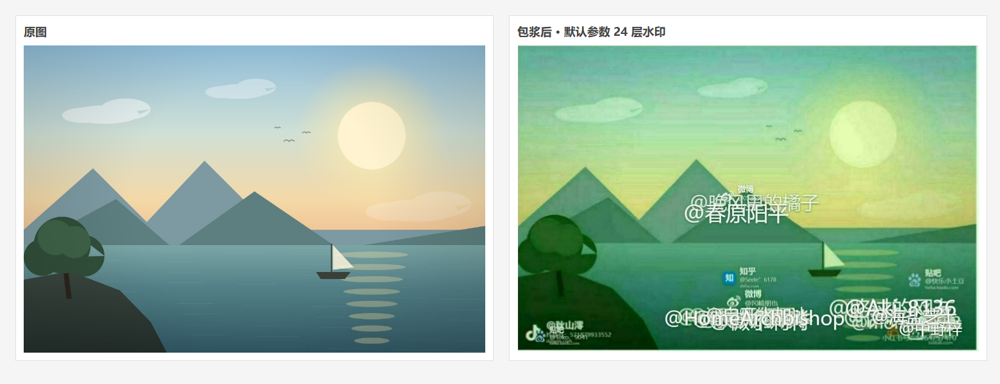
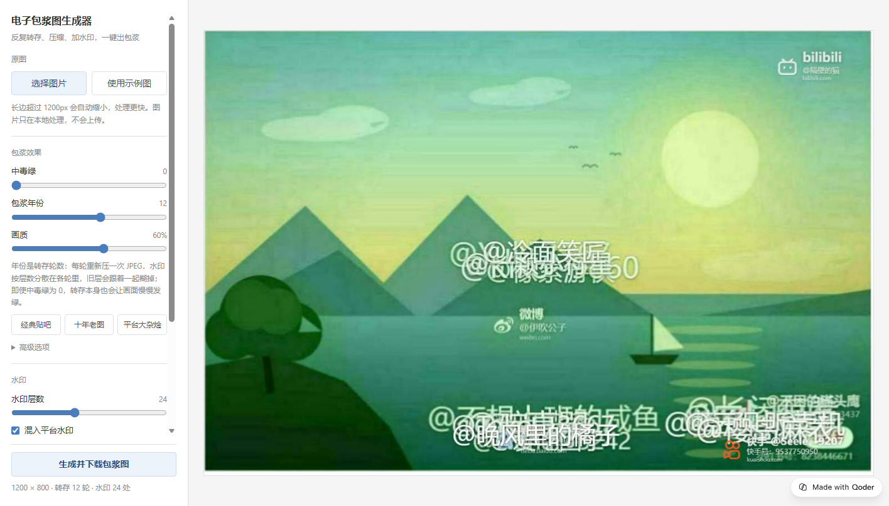
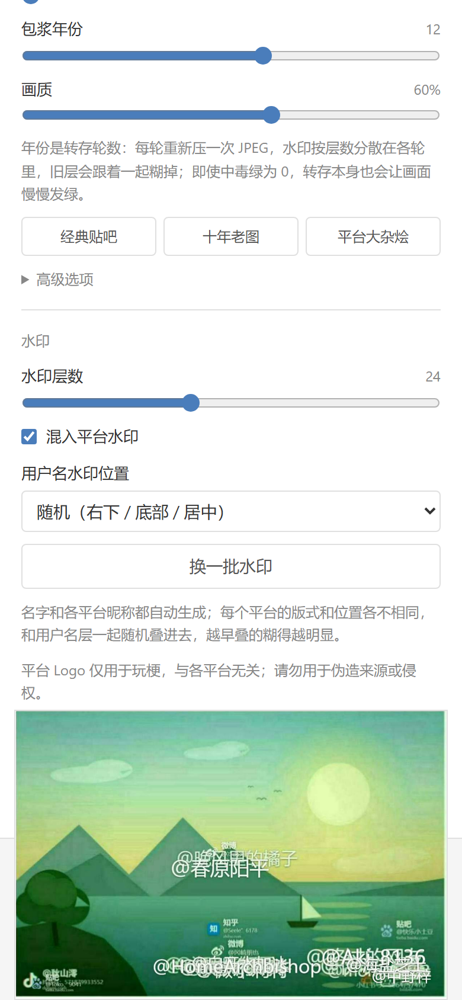
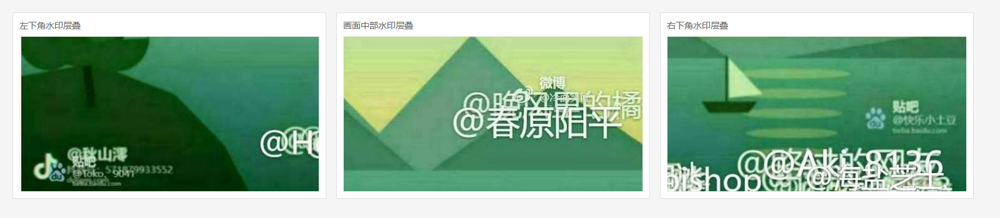

# 电子包浆图生成器

把一张干净的图，反复「转存、压缩、加水印」，做出在网上被传了十年的**电子包浆**。

纯前端单文件，打开就能用，图片不会上传到任何服务器。

**在线使用**：[Qoder Sites](https://dianzi-baojiang-9enf4v6tdio.qoder.zone) · [GitHub Pages](https://jiacheng6.github.io/patina-image-generator/)

## 它能做什么

- **最多 20 轮 JPEG 重压缩**：质量抖动、随机位移与缩放、YUV 色度偏移，模拟反复转存后的绿调、糊边与色块
- **水印层叠**：转存水印与平台水印最多可叠 60 层，越早的水印被压得越糊
- **七个平台水印**：贴吧、微博、B 站、抖音、小红书、快手、知乎，按各自真实的版式与落点绘制
- **三档预设**：经典贴吧 / 十年老图 / 平台大杂烩，一键切换
- **内置示例图**：不用准备素材，点开就能试
- **导出即用**：直接输出 1200×800 JPEG，不依赖任何截图库或 CDN

## 怎么用

1. 拖入或选择一张图（或点「示例图片」）
2. 选一个预设，需要的话再手动调压缩轮数、水印数量与平台
3. 看着右侧预览变成你想要的样子
4. 点「保存图片」

## 技术说明

- 单个 HTML 文件，Canvas 2D 渲染，无框架、无构建步骤、无外部请求
- 水印按层写入渲染管线：第 `n` 层水印在第 `floor(n × 总轮数 ÷ 层数)` 轮压缩时烙进图里，因此旧水印比新水印更糊
- 桌面端 300px 侧栏 + 大图预览，窄屏自动改为上下布局

## 截图

| 桌面端 | 手机端 |
| --- | --- |
|  |  |

平台水印落点特写（左下角 / 中部 / 右下角）：

## 说明

本项目为 [2026 Qoder 高校创造力大赛](https://tianchi.aliyun.com/competition/entrance/532536) 参赛作品，使用 Qoder 开发并部署在 Qoder Sites。平台水印仅用于还原网络图片的视觉风格，与各平台官方无关。